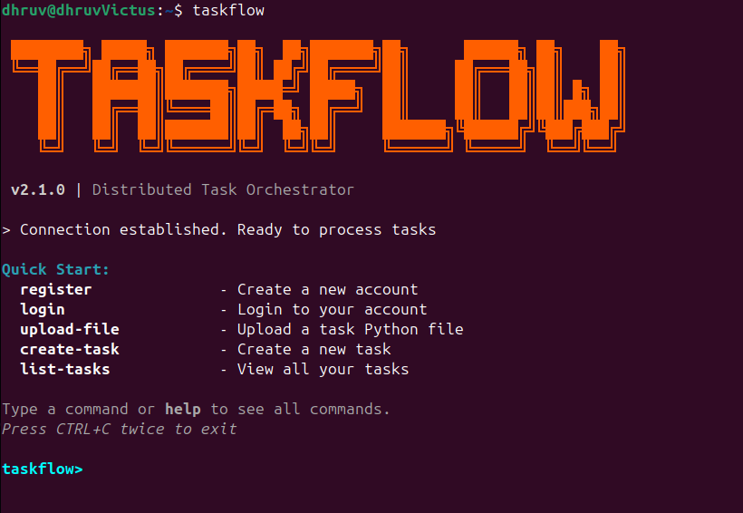
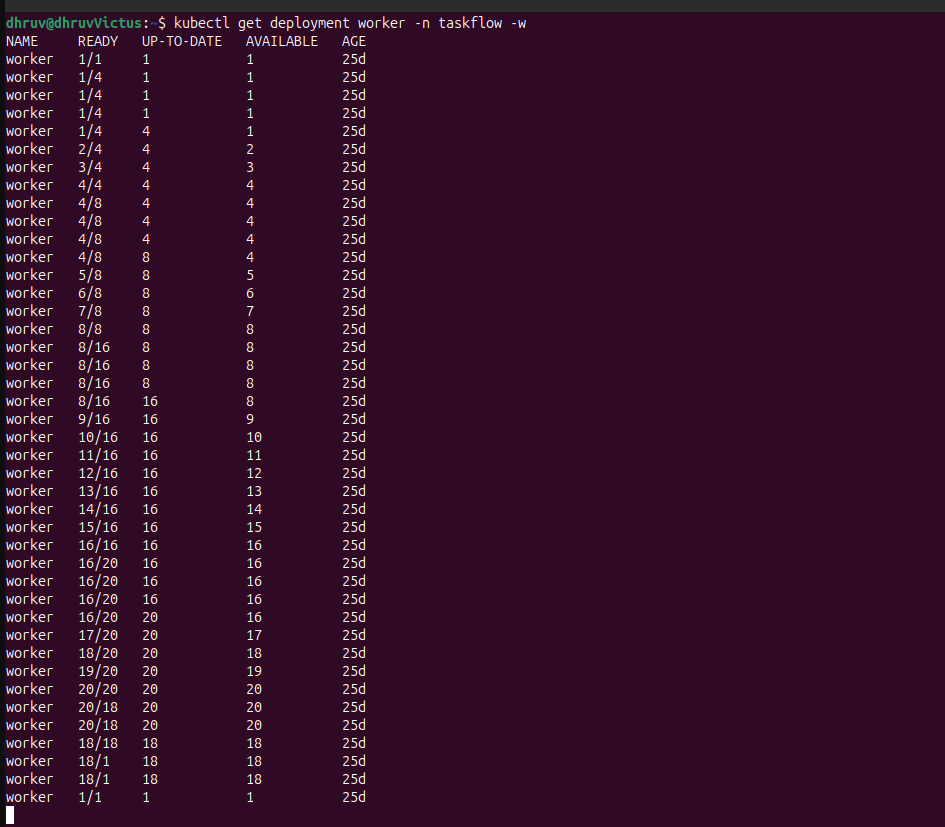
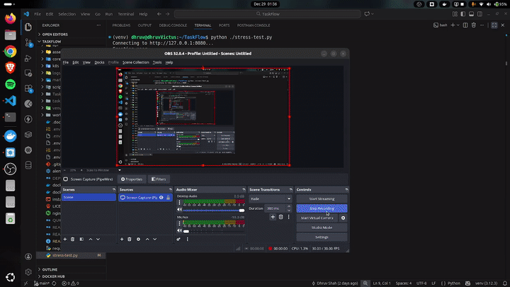

<div align="center">
  <br>
  
  <br>
  <br>
  <h1>TaskFlow</h1>
  
  <p>
    <b>Streamline your workflow with intelligent task management ⚡️</b>
  </p>
  
  
  
  
  
  
  
  

   
  <br />
</div>

## Overview

**TaskFlow v2.1.0** is a production-ready distributed task execution platform featuring **dynamic code execution**, **intelligent autoscaling**, and a **unified CLI command center**. Upload custom Python tasks at runtime and execute them across a fleet of auto-scaling workers—no container rebuilds or manual `kubectl` commands required.

The system leverages **FastAPI** for high-performance task submission, **Redis** for message brokering, **PostgreSQL** for persistence, and **KEDA** for event-driven autoscaling based on queue depth.

### **Key Capabilities**

* **Unified CLI Interface**: Manage the entire lifecycle—from account registration to task deployment and cluster health—directly via the `taskflow` command.
* **CLI Installation**: Install the CLI from the repository or use a Debian package when available.
* **Modular Workers**: Upload and execute custom Python code dynamically without redeploying or rebuilding images.
* **Smart Autoscaling**: KEDA scales workers from 2 to 20 pods based on real-time Redis queue length.
* **Dual-Priority Queues**: Separate high/low priority Redis queues with intelligent routing for critical tasks.
* **Async & Sync Support**: Native support for executing both `def handler()` and `async def handler()` functions.
* **Persistent Storage**: Shared task files across API and worker pods enabled by ReadWriteMany PVCs.
* **Production Native**: Fully orchestrated with automated health checks, graceful shutdowns, and persistent port-forwarding services.

---

## TaskFlow CLI

The CLI manages accounts, Python task files, and task execution from your terminal. It connects to the TaskFlow API at `http://localhost:8080` and stores your login token in the system keyring.



### Install and connect

Start the TaskFlow stack using the [local deployment instructions](#kubernetes-local-deployment-minikube). The CLI requires Python 3.8 or newer and a working system keyring. From the repository root, install it in a virtual environment:

```bash
python3 -m venv .venv
source .venv/bin/activate
python -m pip install ./taskflow_cli
```

The CLI expects the API on port 8080. If it is not already forwarded, run this in a separate terminal while using the CLI:

```bash
kubectl port-forward -n taskflow svc/taskflow-api 8080:80
```

A Debian package may also be available in the project's GitHub releases; install a downloaded package with `sudo dpkg -i ./taskflow-cli.deb`.

### Run your first task

Create a Python file with a synchronous or asynchronous `handler(payload)`. The API wraps the submitted string in a dictionary under `data`:

```python
# hello.py
def handler(payload):
    return {"message": f"Hello, {payload['data']}!"}
```

Run these commands from the directory containing `hello.py`. Registration and login prompt for credentials; login saves the token in your keyring.

```bash
taskflow register
taskflow login
taskflow upload-file hello.py --title hello
taskflow create-task --title hello --payload world
taskflow list-tasks
taskflow get-task 1  # Replace 1 with the ID returned by create-task
```

The upload title must match the title used to create the task. Use `--scheduled-at 5` to schedule a task five minutes from now. `list-tasks` also accepts `--limit`, `--skip`, `--search`, and `--status`. Use `taskflow delete-task <id>`, `taskflow delete-file --title hello`, or `taskflow logout` when needed; these ask for confirmation. `taskflow list-worker-files` inspects files in a worker pod and requires `kubectl` access to the cluster.

Run `taskflow` without arguments to enter the interactive prompt shown above. Enter the same commands without the `taskflow` prefix, type `help` for the command list or `<command> --help` for options, and use `exit` or `quit` to leave. Outside the prompt, use `taskflow --help` or `taskflow <command> --help`.

---

**Workers Auto-Scale & Execute:**
- Queue builds up → Workers scale from 2 to 20 pods
- Each worker loads `process_data.py` and executes `handler()`
- Results stored in database
- Queue empties → Workers scale back to 2 pods

**Task Requirements:**
- Must contain `handler(payload)` function (sync or async)
- Task `title` must match filename (without `.py`)
- Payload passed as dictionary to handler

---

## See TaskFlow in Action

**[taskflow-io.vercel.app](https://taskflow-io.vercel.app/)** - Interactive demonstration with project overview, architecture, and demo videos


  <td style="width: 50%; vertical-align: top;">
    
  </td>
  <td style="width: 50%; vertical-align: top;">
    
  </td>


-----


## Kubernetes local Deployment (Minikube)

TaskFlow includes a **highly automated Makefile system** that streamlines the entire Kubernetes development lifecycle. Deploy the full stack with a single command.

### **Prerequisites**

- [Minikube](https://minikube.sigs.k8s.io/docs/start/) installed
- [kubectl](https://kubernetes.io/docs/tasks/tools/) CLI tool
- [Docker](https://docs.docker.com/get-docker/) (for Minikube driver)

### **Makefile Command Reference**

The Makefile provides a complete set of utilities for managing your local Kubernetes environment:

#### **Make commands**

| Command | Description |
|---------|-------------|
| `make run-local` | **Full local deployment.** Builds images, loads to Minikube, deploys all services with autoscaling. |
| `make build-local` | **Parallel builds.** Builds API, Worker, Queue Manager images simultaneously (3x faster). |
| `make build-local-sequential` | **Sequential builds.** Builds images one-by-one (safer for limited resources). |
| `make load` | Load Docker images into Minikube cluster. |
| `make apply` | Deploy all Kubernetes manifests (ConfigMaps, Infrastructure, Apps, Autoscaling). |
| `make clean` | **Reset.** Deletes the `taskflow` namespace and all resources (**data lost**). |
| `make restart` | **Refresh.** Equivalent to `make clean && make run-local`. |
| `make forward` | Start port forwarding (API: 8080, PgBouncer: 6432). |
| `make stop` | Stop Minikube tunnel and port forwarding. |
| `make logs` | Stream **color-coded logs** from all services (API, Workers, Queue Manager). |
| `make db-shell` | Connect to PostgreSQL with interactive `psql` session. |
| `make status` | Show running pods, services, and deployments. |
| `make watch-scaling` | Monitor worker autoscaling in real-time (HPA + pod count). |
| `make stress` | Submit 200 concurrent tasks via `tests/stress-test.py`. |
| `make autoscale-test` | Run autoscaling test (creates 200 tasks, monitors scaling). |
| `make pull` | Pull pre-built images from GHCR (for production deployment). |
| `make prune` | Free up disk space by deleting Docker build cache. |
| `make secrets` | Generate `k8s/01-secrets.yaml` with development credentials. |
| `make install-keda` | Install KEDA autoscaling operator via Helm. |
| `make help` | Display all available commands with descriptions. |

---

### **Disk Space Management**

If Docker consumes too much disk space:

```bash
make prune
```

This removes:
- All Docker build cache (`docker builder prune --all`)
- Dangling/unused images (`docker image prune`)

Verify reclaimed space with:
```bash
docker system df
```

---


## Contributing

Contributions are welcome! Please feel free to submit a Pull Request. For major changes, please open an issue first to discuss what you would like to change.

## License

This project is licensed under the MIT License - see the [LICENSE](LICENSE) file for details.

---


